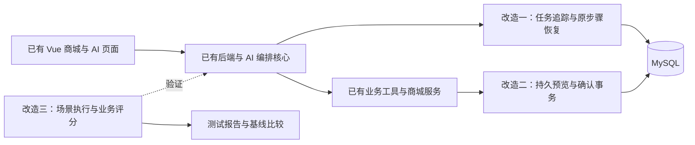

# Shopping Agent Plus · 购物 Agent 可靠性改造

> 基于 [xinconner/shopping-agent-ai](https://github.com/xinconner/shopping-agent-ai) 的二次开发项目，感谢原作者 xinconner。本仓库重点展示在已有商城与 AI 购物助手基础上完成的三项自主改造：**购物任务可追踪、失败可恢复；订单预览与用户确认闭环；Agent 工程验证与业务完整性评价体系。**

商城基础、Spring AI 工具调用、SSE、RAG 和会话记忆沿用原项目。本文按照“问题 → 方法 → 效果”说明本 Fork 的增量，详细归属见 [来源与贡献边界](docs/attribution.md)。

[架构设计](docs/architecture.md) · [运行指南](docs/running.md) · [数据库迁移](docs/database-migrations.md) · [实验结果](docs/experiments.md) · [GitHub 整理指南](docs/github-publishing.md)

## 改造总览

| 改造 | 要解决的问题 | 主要增量 | 验证依据 |
|---|---|---|---|
| ① 购物任务可追踪、失败可恢复 | 断线后无法判断操作结果，重新执行可能重复加购 | 稳定请求身份、任务/步骤持久化、业务幂等、对账与原步骤恢复 | 8 并发、响应丢失、事务回滚、权限和恢复上限测试 |
| ② 订单预览与用户确认闭环 | 原预览与最终成交缺乏持久关联，确认重试结果不确定 | MySQL 快照与指纹、显式确认、锁定重校验、原子提交与结果回放 | 23 项订单确认集成测试及浏览器确认路径 |
| ③ Agent 工程验证与业务完整性评价体系 | 接口或模型回复成功无法证明业务数据正确 | 16 类场景、独立 SQL 判定、7 类负对照、统一脚本及基线报告 | 两轮相同配置：每轮 48/48 场景样本、156/156 后端测试 |

## 原项目提供的基础

原项目已有登录认证、商品、购物车、订单和前后端页面，以及 Spring AI 原生工具调用、混合 RAG、Redis 会话记忆和基本工具权限约束。用户确认下单、模型不直接支付的设计也已存在；本次第二项改造重点是持久化、内容绑定、事务一致性与异常恢复，不能表述为首次引入用户确认。

沿用技术：Java 21、Spring Boot、Spring AI、MyBatis-Plus、MySQL、Redis、Milvus，以及 Vue 3、TypeScript、Vite。依赖版本以 [pom.xml](project-backend/pom.xml)、[package.json](project-frontend/package.json) 与 [pnpm-lock.yaml](project-frontend/pnpm-lock.yaml) 为准。

## 改造一：购物任务可追踪、失败可恢复

**问题。** 工具执行成功但流式连接中断时，用户无法确认是否已经加购；重新请求可能再次进入模型规划。内存审计和日志不足以支撑刷新后的状态查询，更不能将异常直接解释为“没有副作用”。

**方法。** 前端为一次主动请求生成稳定 `clientRequestId`，重试复用原身份；后端以用户和请求标识唯一约束取得任务执行权，保存任务、步骤参数、执行结果及最终回复。购物车操作记录与业务修改同事务提交。查询先按业务记录对账，已成功的操作直接返回结果；未完成步骤仅在符合资格、用户确认原写操作后按保存参数恢复，不重新调用模型规划。

**效果。** 阶段验收完成 70 项后端测试；8 个并发同请求仅一个取得执行权。提交后响应丢失与恢复响应丢失场景均保持单次业务写入，并通过浏览器查询、恢复和刷新路径验证。详见 [阶段报告](project-backend/verification/task-recovery-final-2026-11-26.json)。

**实现入口：** [JdbcAgentRunService](project-backend/src/main/java/com/example/service/ai/impl/JdbcAgentRunService.java)、[AgentStepReconciler](project-backend/src/main/java/com/example/service/ai/impl/AgentStepReconciler.java)、[AgentRecoveryService](project-backend/src/main/java/com/example/service/ai/impl/AgentRecoveryService.java)、[AI 页面](project-frontend/src/pages/AiAssistantPage.vue)，迁移 V8–V10。

**边界。** 每个步骤最多两次恢复尝试；不是任意任务自动恢复，也不是全系统 exactly-once。订单预览、下单和支付不由通用恢复器重做；原任务中断状态不会因单个步骤恢复而伪装成整段任务成功。

## 改造二：订单预览与用户确认闭环

**问题。** 原预览依赖 Redis 生命周期，页面跳转后可能重新生成预览；用户无法持久查询原预览是否成交。价格校验与扣库存之间存在并发变化窗口，重复确认与响应丢失需要确定的成交依据。

**方法。** 将原预览保存为 MySQL 快照，记录用户、内容指纹、有效期、确认键和订单关联。AI 页面携带原 `draftId` 跳转；用户核对并显式确认后，服务端锁定草稿、购物车和商品，再次校验价格、数量与内容，在同一事务写订单/明细、扣库存、清购物车并绑定确认结果。确认响应丢失时先查原预览；同一草稿重复确认返回原订单。

**效果。** 23/23 真实 MySQL 订单确认集成测试通过；8 并发同键或换键确认同一草稿均只生成一笔订单、扣一次库存。通过浏览器“确认成功响应丢失 → 查询找回 → 刷新仍为原订单”路径。阶段报告包含这 23 项及 50 项回归，不能与第三项测试总数相加。详见 [确认闭环报告](project-backend/verification/order-confirmation-2026-11-26.json)。

**实现入口：** [OrderDraftStore](project-backend/src/main/java/com/example/service/order/impl/OrderDraftStore.java)、[JdbcOrderDraftService](project-backend/src/main/java/com/example/service/order/impl/JdbcOrderDraftService.java)、[OrderServiceImpl](project-backend/src/main/java/com/example/service/order/impl/OrderServiceImpl.java)、[订单页面](project-frontend/src/pages/OrdersPage.vue)，迁移 [V11](project-backend/src/main/resources/db/migration/V11__persist_order_confirmation.sql)。

**边界。** 预览不预占库存，条件变化必须重新预览；确认只创建待支付订单。支付仍是已有的模拟业务，不代表真实支付渠道接入。

## 改造三：Agent 工程验证与业务完整性评价体系

**问题。** 分散的接口测试不能回答一次购物任务是否符合预期。即使模型声称完成，也可能出现错误商品、金额不符、重复扣库存、越权修改或执行记录缺失。

**方法。** 建立版本化场景集，通过真实业务工具与隔离 MySQL 执行；独立核对订单金额和快照、购物车商品与数量、库存守恒、用户隔离及持久化执行轨迹。使用故意制造错误状态的负对照验证评分器，再由统一入口汇总 JUnit、来源摘要和清理结果，输出 JSON/Markdown 与兼容基线比较。缺失样本、跳过测试、源码变化或环境清理失败都会使门禁失败。

**效果。** 最终两轮相同配置均通过。评测还发现并修复了“工具已明确返回库存不足，正确解释却被事实校验器误拒”的缺陷；新增定向回归，拒绝结果不能被用来编造库存数量或售价。

| 实测项目（2026-11-27） | 每轮结果 | 含义 |
|---|---|---|
| 场景样本 | 48/48 | 16 类场景各运行 3 次 |
| 恢复场景 | 6/6 | 已包含在 48 个样本中 |
| 后端测试 | 156/156 | 已包含 48 个场景样本与 7 个业务评分负对照 |
| 报告器测试 | 12/12 | 验证缺失证据、错误判定和失败门禁 |
| 前端 | 类型检查、生产构建通过 | 不是浏览器交互测试 |
| 数据库 | MySQL 8.0.46、V1–V11 | 独立临时实例，测试后停止并清理 |

**实现入口：** [场景集](project-backend/src/test/resources/evaluation/shopping-scenarios.json)、[AgentBusinessEvaluationIT](project-backend/src/test/java/com/example/service/ai/impl/AgentBusinessEvaluationIT.java)、[BusinessIntegrityOracle](project-backend/src/test/java/com/example/service/ai/impl/BusinessIntegrityOracle.java)、[一键入口](project-backend/scripts/run-agent-evaluation.ps1)。

[最终报告](project-backend/verification/agent-evaluation-2026-11-27.md) · [逐样本 JSON](project-backend/verification/agent-evaluation-2026-11-27.json) · [同配置基线](project-backend/verification/agent-evaluation-baseline-2026-11-27.json) · [指标定义与复现说明](docs/agent-engineering-evaluation.md)

**边界。** 本轮为 scripted 工程实验：工具计划由场景提供，业务执行真实。真实模型 live 入口已实现但未配置运行，不能将 48/48 写成“模型购物成功率 100%”。RAG、长对话、生产负载与生产 JWT 全链路不属于这些数字的覆盖范围。

## 架构概览



完整组件关系、故障恢复及确认时序见 [架构设计](docs/architecture.md)。

## 快速验证

不需要真实模型密钥即可运行工程验收；需要本机 JDK 21、Maven 3.9+、MySQL 8.0、Python 3.9+、Node 24 与 pnpm，首次运行需准备依赖。

```powershell
# 在仓库根目录开始
Set-Location project-frontend
pnpm install --frozen-lockfile
Set-Location ../project-backend
./scripts/run-agent-evaluation.ps1 -JavaHome '<JDK 21 的安装目录>'
```

报告写到 `project-backend/target/agent-evaluation-<运行ID>/`。可用 `-MavenCommand`、`-MySqlBin`、`-PythonCommand`、`-NodeCommand` 指定安装位置。完整商城运行还需 Redis、Milvus 和模型配置，步骤见 [运行指南](docs/running.md)。

## 仓库导航

```text
README.md                         # 来源、三项增量与实测效果
 docs/                            # 架构、运行、迁移、实验、发布及归属
 project-backend/
   src/main/java/                 # 基础业务及改造实现
   src/main/resources/db/migration/ # V1–V7 基础；V8–V11 改造
   src/test/java/                 # 单元、数据库、场景与负对照测试
   src/test/resources/evaluation/ # 固定场景定义
   scripts/                       # 隔离 MySQL、评测与报告脚本
   verification/                  # 已归档的实验报告与测试截图
 project-frontend/src/            # 前端与任务恢复、原预览确认交互
```

[历史阶段记录](docs/history/implementation-notes.md)保留当时的实现和验收范围；其中过时配置不作为当前启动指南。原作者与许可状态说明见 [来源与贡献边界](docs/attribution.md)。
