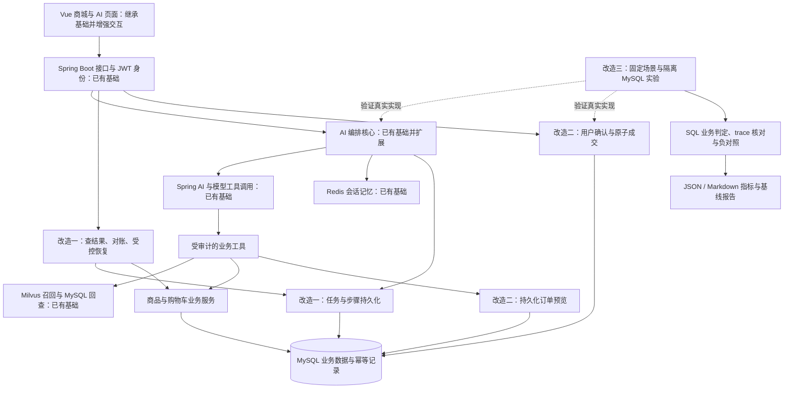
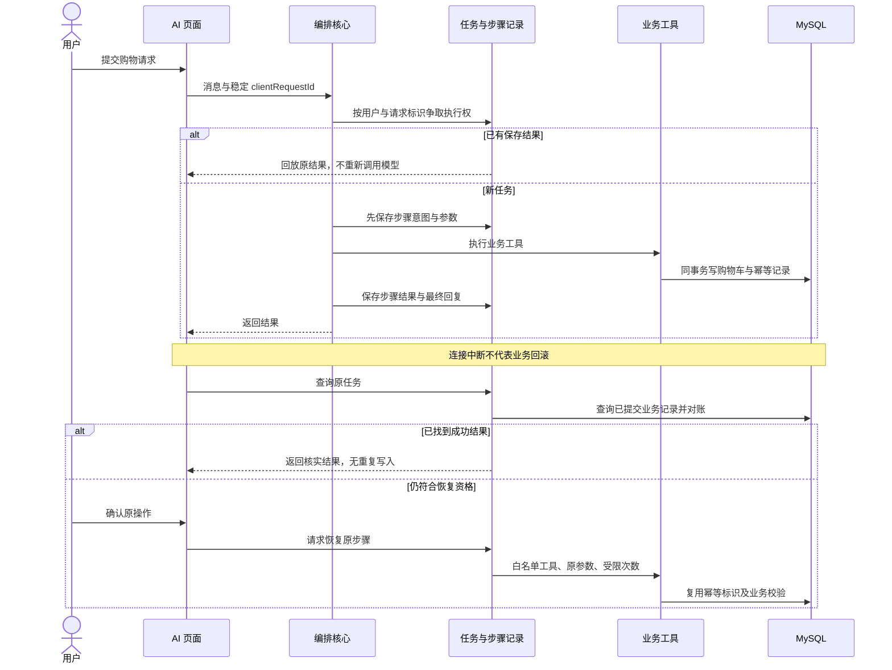
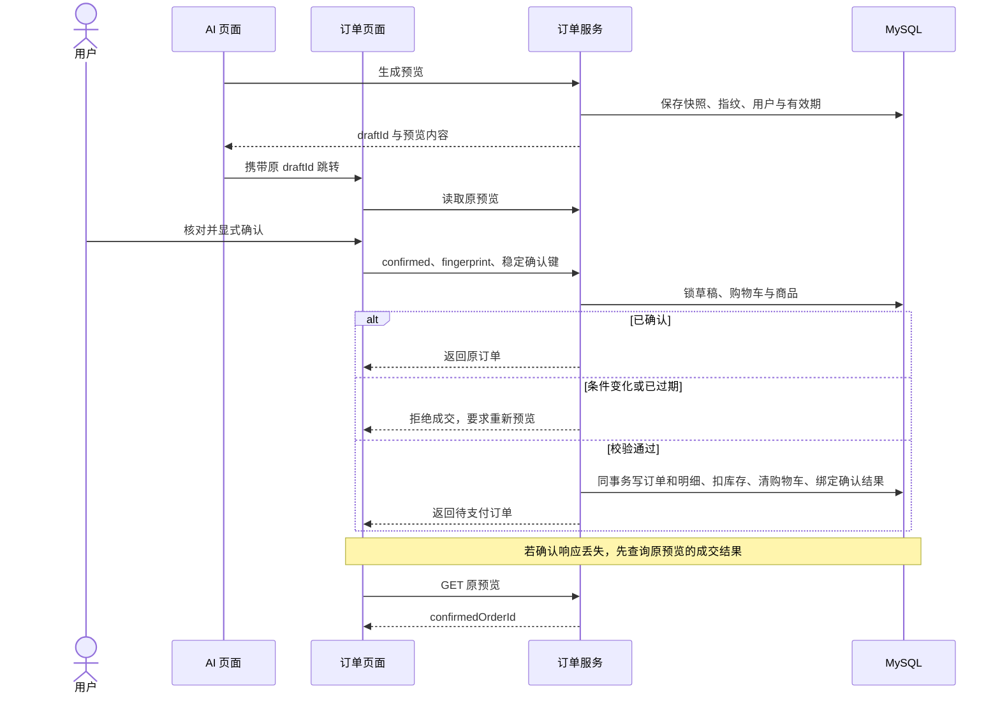
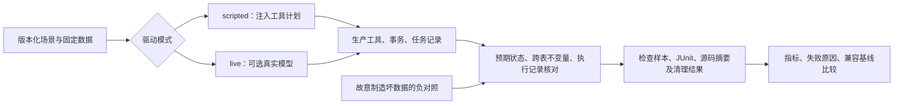

# 架构与改造边界

以下图对应当前实现。商城、JWT、Spring AI 工具调用、RAG 与 Redis 记忆属于继承的基础；标注“改造”的部分为本次增量。架构图表示逻辑依赖，不代表已完成生产部署或所有外部服务的端到端验收。

## 整体架构

模型可调用查询、购物车和预览工具；没有确认下单或支付工具。确认接口从服务端认证上下文取得用户身份，不能通过工具参数指定另一个用户。

## 改造一：结果先查询，恢复按原参数执行

恢复不是重新运行整个 Agent，也不会让模型生成替代参数。每个步骤最多 2 次恢复尝试；订单预览、确认和支付不走通用步骤恢复。步骤恢复成功后，原任务仍可以保持 INTERRUPTED，避免伪造整段任务完成。

入口：[JdbcAgentRunService](../project-backend/src/main/java/com/example/service/ai/impl/JdbcAgentRunService.java)、[AgentRecoveryService](../project-backend/src/main/java/com/example/service/ai/impl/AgentRecoveryService.java)、[AgentStepReconciler](../project-backend/src/main/java/com/example/service/ai/impl/AgentStepReconciler.java)。

## 改造二：原预览与确认结果绑定

预览不预占库存；确认时必须再次核对条件。快照指纹用于识别内容变化，不代替用户认证。确认只创建待支付订单，不自动支付。

入口：[OrderDraftStore](../project-backend/src/main/java/com/example/service/order/impl/OrderDraftStore.java)、[JdbcOrderDraftService](../project-backend/src/main/java/com/example/service/order/impl/JdbcOrderDraftService.java)、[OrderServiceImpl](../project-backend/src/main/java/com/example/service/order/impl/OrderServiceImpl.java)。

## 改造三：验证行为与业务事实

默认 scripted 验证工程行为，不证明模型自主选工具能力。live 入口已实现，本轮尚未执行；它使用专用非流式传输层，也不等于生产 SSE 全链路测试。具体指标分母与边界见 [工程评价说明](agent-engineering-evaluation.md)。
